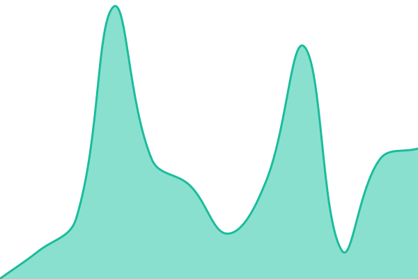
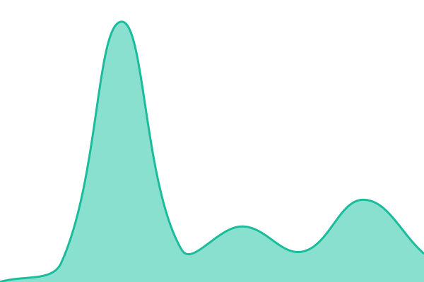
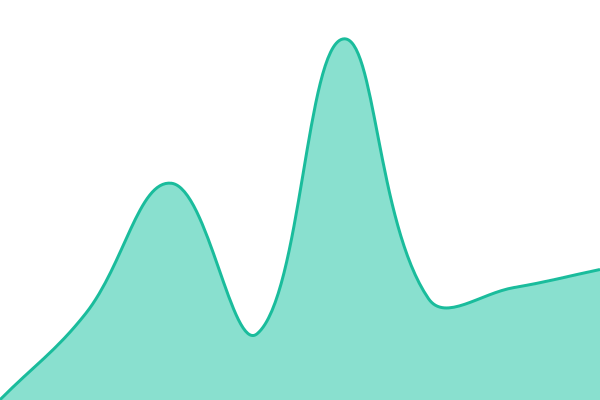
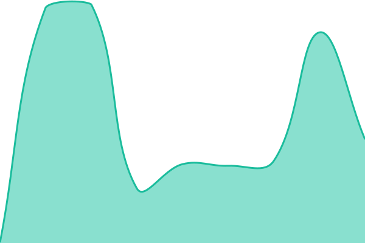

# [📈 Live Status](https://uptime.projectnine.com): <!--live status--> **🟩 All systems operational**

This repository contains the open-source uptime monitor and status page for [Justin Braithwaite](https://www.storr.co), powered by [Upptime](https://github.com/upptime/upptime).

With [Upptime](https://upptime.js.org), you can get your own unlimited and free uptime monitor and status page, powered entirely by a GitHub repository. We use [Issues](https://github.com/jbraithwaite/uptime/issues) as incident reports, [Actions](https://github.com/jbraithwaite/uptime/actions) as uptime monitors, and [Pages](https://uptime.projectnine.com) for the status page.

<!--start: status pages-->
<!-- This summary is generated by Upptime (https://github.com/upptime/upptime) -->
<!-- Do not edit this manually, your changes will be overwritten -->
<!-- prettier-ignore -->
| URL | Status | History | Response Time | Uptime |
| --- | ------ | ------- | ------------- | ------ |
|  [Robert Turner](https://www.robertturner.org) | 🟩 Up | [robert-turner.yml](https://github.com/jbraithwaite/uptime/commits/HEAD/history/robert-turner.yml) | 

 320ms
     
 | 

<a href="https://uptime.projectnine.com/history/robert-turner">100.00%</a>
    

|  [Blessed Footsteps](https://www.blessedfootsteps.org) | 🟩 Up | [blessed-footsteps.yml](https://github.com/jbraithwaite/uptime/commits/HEAD/history/blessed-footsteps.yml) | 

 275ms
     
 | 

<a href="https://uptime.projectnine.com/history/blessed-footsteps">100.00%</a>
    

|  [SF Bahá'í](https://www.sfbahai.org) | 🟩 Up | [sf-baha-i.yml](https://github.com/jbraithwaite/uptime/commits/HEAD/history/sf-baha-i.yml) | 

 1928ms
     
 | 

<a href="https://uptime.projectnine.com/history/sf-baha-i">99.73%</a>
    

|  [Medlibes](https://medlibes.com) | 🟩 Up | [medlibes.yml](https://github.com/jbraithwaite/uptime/commits/HEAD/history/medlibes.yml) | 

 224ms
     
 | 

<a href="https://uptime.projectnine.com/history/medlibes">97.94%</a>
    

|  [Medlibes (database)](https://medlibes.com/letter/a) | 🟩 Up | [medlibes-database.yml](https://github.com/jbraithwaite/uptime/commits/HEAD/history/medlibes-database.yml) | 

 156ms
     
 | 

<a href="https://uptime.projectnine.com/history/medlibes-database">97.95%</a>
    

|  [Project Nine](https://www.projectnine.com) | 🟩 Up | [project-nine.yml](https://github.com/jbraithwaite/uptime/commits/HEAD/history/project-nine.yml) | 

 254ms
     
 | 

<a href="https://uptime.projectnine.com/history/project-nine">97.97%</a>
    

|  [Project Nine Blog](https://blog.projectnine.com) | 🟩 Up | [project-nine-blog.yml](https://github.com/jbraithwaite/uptime/commits/HEAD/history/project-nine-blog.yml) | 

 284ms
     
 | 

<a href="https://uptime.projectnine.com/history/project-nine-blog">97.98%</a>
    

|  [Minna](https://minna.projectnine.com) | 🟩 Up | [minna.yml](https://github.com/jbraithwaite/uptime/commits/HEAD/history/minna.yml) | 

 276ms
     
 | 

<a href="https://uptime.projectnine.com/history/minna">98.00%</a>
    

|  [Project Nine CDN](https://cdn.projectnine.com) | 🟩 Up | [project-nine-cdn.yml](https://github.com/jbraithwaite/uptime/commits/HEAD/history/project-nine-cdn.yml) | 

 230ms
     
 | 

<a href="https://uptime.projectnine.com/history/project-nine-cdn">98.01%</a>
    

<!--end: status pages-->

[**Visit our status website →**](https://uptime.projectnine.com)

## 📄 License

- Powered by: [Upptime](https://github.com/upptime/upptime)
- Code: [MIT](./LICENSE) © [Justin Braithwaite](https://www.storr.co)
- Data in the `./history` directory: [Open Database License](https://opendatacommons.org/licenses/odbl/1-0/)
